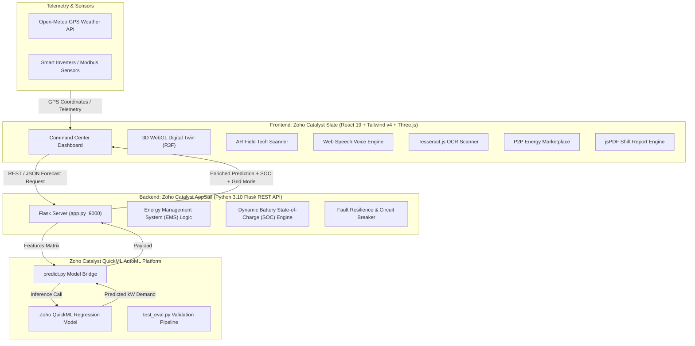

# ⚡ GridSense - Smart Energy Microgrid & Demand Forecasting Engine

[](https://github.com/Shaik-Abdul-Sammed/GridSense)
[](https://catalyst.zoho.com/)
[](LICENSE)

> **Next-Generation Autonomous Microgrid Energy Management System (EMS)** designed for modern decentralized energy grids. Built on **Zoho Catalyst (AppSail & Slate)** and powered by **Zoho QuickML AutoML**, GridSense dynamically forecasts energy demand, orchestrates Battery Energy Storage Systems (BESS), mitigates transformer failure through real-time predictive analytics, and features an interactive 3D WebGL Digital Twin command center.

---

## 📌 Executive Summary & HackSphere 3.0 Challenge

Modern electrical grids face severe instability due to volatile renewable generation, localized high-demand spikes (EV fast charging, industrial loads), and aging distribution transformers.

**The GridSense Solution:**
- **Zero-Latency Demand Forecasting:** Uses **Zoho QuickML** to predict hourly energy consumption with high fidelity based on weather, solar irradiance, ambient temperature, and historical demand.
- **Dynamic BESS Dispatch Strategy:** Automatically balances microgrid energy flow. During low solar output or peak pricing, the system discharges stored battery reserves; during peak solar generation and low demand, excess green energy is captured into storage.
- **Proactive Transformer Health & RUL Forecaster:** Calculates a rolling thermal/mechanical stress score to alert grid operators hours before critical transformer failure.
- **Enterprise Command Center:** An immersive operations center featuring a 3D WebGL Digital Twin, Augmented Reality (AR) field diagnostics, optical meter OCR ingestion, voice-activated controls, and peer-to-peer (P2P) local energy trading.

---

## 🏗️ System Architecture

GridSense is architected for ultra-high availability, low latency, and modular cloud deployment on **Zoho Catalyst**:



---

## 🚀 "Hackathon Winning" Advanced Capabilities

### 1. 🌐 3D WebGL Digital Twin Substation
- Built with **Three.js** and `@react-three/fiber` / `@react-three/drei`.
- Real-time 3D rendering of the high-voltage Substation Grid Tower, Battery BESS Enclosure, and Smart Microgrid Community.
- Features **particle-based energy flow streams** that dynamically change trajectory and glow color based on grid state (Grid-to-Battery, Battery-to-House, or Direct Grid).

### 2. 🥽 Augmented Reality (AR) Field Technician HUD
- Uses device camera stream (`navigator.mediaDevices.getUserMedia`) with interactive futuristic HUD overlays.
- Displays bounding boxes, real-time diagnostic telemetry, busbar thermals, vibration harmonics, and simulated thermal sensor toggles.

### 3. 📷 Optical Meter Ingestion via OCR
- Powered by client-side **Tesseract.js**.
- Operators can upload or snap a photo of physical analog or digital kilowatt-hour (kWh) meters to instantly extract numerical readings and override simulation load curves.

### 4. ⚠️ Predictive Failure Forecaster (Transformer Stress & RUL)
- Continuously calculates a rolling **Transformer Stress Score (0–100%)** combining high demand (>160 kW), extreme ambient heat (>35°C), and hour-over-hour load spikes.
- Computes **Remaining Useful Life (RUL)** with visual health gauges and alerts operators up to 4 hours prior to catastrophic dielectric breakdown.

### 5. 🎙️ Voice Command & Audio Announcer System
- Integrates browser **Web Speech Recognition** (`webkitSpeechRecognition`) for hands-free grid management (*"Start forecast"*, *"Fast forward"*, *"Switch to battery mode"*, *"Emergency stop"*).
- Features automated **SpeechSynthesis** audio announcer that alerts engineers audibly during critical alerts.

### 6. 🤝 Peer-to-Peer (P2P) Transactive Energy Marketplace
- Dedicated `/market` route allowing local prosumers with rooftop solar to trade excess clean kilowatt-hours with neighbors in real time.
- Features live order books, transaction history, automated matching engine, and settlement logs.

### 7. 🚁 Autonomous Substation Drone Fleet
- Real-time telemetry tracking autonomous inspection drones patrolling transmission towers and solar farms.
- Live drone battery levels, GPS waypoints, transmission signal strength, and automated dispatch triggers when transformer health drops below 60%.

### 8. 🌦️ "What-If" Climate Simulator
- Allows grid operators to stress-test the microgrid under extreme conditions:
  - ☀️ **Extreme Heatwave:** Elevates temperatures to 42°C, spiking HVAC demand.
  - ☁️ **Cloud Cover / Monsoon:** Slashing solar generation to near zero.
  - ❄️ **Freezing Arctic Vortex:** Simulates grid heating surge with reduced battery chemical efficiency.

### 9. 👾 Gamified "Grid Defender" Mini-Game
- Tactical microgrid defense drill where operators must manually shed loads, dispatch auxiliary diesel/battery reserves, and maintain grid frequency at 50 Hz under emergency surges.

### 10. 📄 Enterprise PDF Shift Handover Report Generator
- 1-click generation of certified executive shift handover reports using `html2canvas` and `jspdf`.
- Includes high-res canvas chart captures, alarm logs, peak load metrics, and compliance sign-off blocks.

---

## 💻 Tech Stack Breakdown

| Layer | Technologies | Description |
| :--- | :--- | :--- |
| **Frontend Framework** | React 19, Vite 6 | Lightning-fast SPA with instant HMR and optimized bundle splitting |
| **Styling & Design** | Tailwind CSS v4, Lucide Icons | Responsive, glassmorphic dark-theme command center UI |
| **3D & Visualizations** | Three.js, React Three Fiber, Recharts | Interactive WebGL canvas, particle streams, and responsive charts |
| **AI / Machine Learning** | Zoho Catalyst QuickML | Automated regression model predicting hourly electrical demand |
| **Backend & API** | Python 3.10, Flask, Flask-CORS | REST service running on Zoho Catalyst AppSail |
| **Cloud Hosting** | Zoho Catalyst | Slate (Client Hosting) + AppSail (Serverless Python Container) |
| **Edge Compute** | Tesseract.js, Web Speech API | Client-side OCR and voice recognition without backend overhead |

---

## ⚡ QuickML Model Contract & Evaluation

The predictive engine is trained on high-density microgrid telemetry and exposed via standard Catalyst contracts:

### 1. Model Input Features:
- `timestamp`: Hourly timestamp (`YYYY-MM-DD HH:MM:SS`)
- `temperature_2m`: Ambient dry-bulb temperature in °C
- `relative_humidity_2m`: Relative humidity percentage
- `shortwave_radiation`: Solar irradiance in W/m²
- `solar_generation_kw`: Active solar generation
- `battery_soc`: Starting state of charge (0–100%)

### 2. Model Prediction Output:
- `predicted_demand_kw`: Predicted microgrid electrical load in kilowatts (kW)
- `grid_mode`: Recommended operational state (`SOLAR_SURPLUS`, `BATTERY_DISPATCH`, or `GRID_IMPORT`)
- `battery_soc`: Updated battery reserve level

### 3. Verification Scripts:
- **`predict.py`**: Handles single-row and batch inference directly against the trained QuickML model endpoint.
- **`test_eval.py`**: Runs evaluation against `sample_test_input.csv` and outputs RMSE, MAE, and latency benchmarks.

```bash
# Run model evaluation locally
python test_eval.py
```

---

## 🛠️ Local Development & Setup Guide

### Prerequisites
- **Node.js** >= 18.0.0
- **Python** >= 3.10
- **npm** or **pnpm**

---

### Step 1: Clone the Repository
```bash
git clone https://github.com/Shaik-Abdul-Sammed/GridSense.git
cd GridSense
```

### Step 2: Set Up Backend (AppSail Flask API)
```bash
# Optional: create a virtual environment
python -m venv venv
source venv/bin/activate  # On Windows: venv\Scripts\activate

# Install dependencies
pip install flask flask-cors requests

# Start the Flask forecast microservice on Port 9000
python app.py
```
> The API will be active at `http://localhost:9000`. Test endpoint: `http://localhost:9000/forecast`

### Step 3: Set Up Frontend (Slate React Dashboard)
```bash
cd gridsense-ui

# Install dependencies (use legacy peer deps for three fiber compatibility)
npm install --legacy-peer-deps

# Create / verify your .env file
echo "VITE_API_URL=http://localhost:9000/forecast" > .env

# Start the Vite development server
npm run dev
```
> Open your browser at `http://localhost:5173` to access the Command Center.

---

## 🧪 Production Build & Code Quality

GridSense enforces strict code quality and optimized bundle splitting:

```bash
cd gridsense-ui

# Run ESLint (enforces 0 errors, 0 warnings)
npm run lint

# Build production assets with manual code-chunking
npm run build
```

### 📦 Optimized Chunking Architecture:
To ensure instantaneous page loads, the Vite production configuration splits large third-party modules into discrete cached chunks:
- **`three-[hash].js`**: Three.js, React Three Fiber, React Three Drei, WebGL shaders
- **`ocr-[hash].js`**: Tesseract.js worker & recognition language files
- **`pdf-[hash].js`**: jsPDF & html2canvas rendering engine
- **`charts-[hash].js`**: Recharts and D3 dependencies
- **`react-[hash].js`**: React core, ReactDOM, and React Router DOM

---

## ⚙️ Environment Variables

| Variable | Default Value | Description |
| :--- | :--- | :--- |
| `VITE_API_URL` | `http://localhost:9000/forecast` | REST endpoint for the microgrid forecast service |
| `PORT` | `9000` | Port for the Python Flask backend service |

---

## 📂 Project Structure

```
GridSense/
├── app.py                      # Flask backend API service (Catalyst AppSail)
├── predict.py                  # QuickML model inference connector
├── test_eval.py                # Model evaluation & benchmarking pipeline
├── train_telemetry.csv         # Microgrid training dataset
├── sample_test_input.csv       # Test dataset for 24-hour simulation
├── catalyst.json               # Zoho Catalyst configuration
├── app-config.json             # AppSail deployment descriptor
├── README.md                   # Repository documentation
└── gridsense-ui/               # React Frontend (Catalyst Slate)
    ├── package.json            # Node.js dependencies & scripts
    ├── vite.config.js          # Vite config with manual chunk splitting
    ├── index.html              # HTML5 entrypoint
    ├── src/
    │   ├── main.jsx            # React root mount
    │   ├── App.jsx             # Router entrypoint & layout provider
    │   ├── pages/
    │   │   ├── Dashboard.jsx   # Primary Live Telemetry Command Center
    │   │   ├── Analytics.jsx   # QuickML Model Performance & Residuals
    │   │   ├── History.jsx     # Event Logs & Automated Audit Trail
    │   │   ├── Settings.jsx    # Microgrid Thresholds & Config
    │   │   ├── Market.jsx      # P2P Energy Trading Marketplace
    │   │   └── Drones.jsx      # Drone Patrol Substation Hub
    │   ├── components/
    │   │   ├── Substation3D.jsx        # 3D WebGL Digital Twin (Three.js)
    │   │   ├── FieldTechAR.jsx         # Augmented Reality Camera Scanner
    │   │   ├── MeterScanner.jsx        # Optical OCR Analog/Digital Ingestion
    │   │   ├── DroneFleet.jsx          # Substation Patrol Drone System
    │   │   ├── GridDefenderModal.jsx   # Tactical Overload Mini-Game
    │   │   ├── PowerFlowDiagram.jsx    # SVG Animated Power Flow
    │   │   ├── LoadCurveChart.jsx      # Recharts Interactive Demand Curve
    │   │   ├── WeatherSync.jsx         # GPS Open-Meteo Integration
    │   │   └── ...                     # Gauges, Banners, Headers
    │   ├── hooks/
    │   │   ├── useVoiceCommands.js     # Web Speech Recognition Hook
    │   │   └── useVoiceAlerts.js       # SpeechSynthesis Alert Hook
    │   └── utils/
    │       ├── failurePredictor.js     # Transformer Health & RUL Forecaster
    │       └── demoData.js             # High-Stress Demo Scenarios
```

---

## 👥 HackSphere 3.0 Team

- **Shaik Abdul Sammed** - *Lead Architect & Full-Stack AI Engineer*
- **Team Hulk** - *HackSphere 3.0 Finalists*

---

## 📜 License

This project is licensed under the MIT License - see the [LICENSE](LICENSE) file for details.
